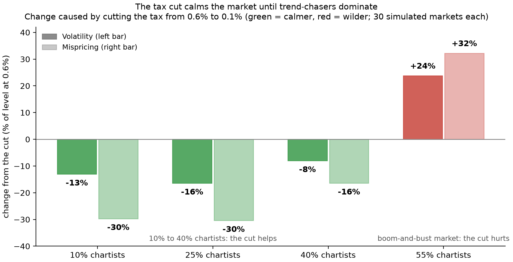

# The Market Simulation Project, Explained Simply

*A plain-language guide for readers new to the topic. For the technical details see
[`ODD.md`](ODD.md) (model description) and [`results.md`](results.md) (full results).*

## The short version

We built a computer simulation of a stock market to answer one question: **does a tax on stock trades make prices calmer or wilder?** The Philippines cut its stock trading tax from 0.6% to 0.1% in July 2025. We used the simulation to see what that cut does when everything else is held fixed.

Our answer: **it depends on who is trading.** When most traders are sensible, the tax cut makes the market calmer and smoother. When the market is dominated by trend-chasers, the same cut makes booms and crashes bigger.

These results describe how our simulated market behaves. They are not a forecast for the real Philippine Stock Exchange.

## The real-world question

On 1 July 2025, the Philippines cut its **stock transaction tax** from 0.6% to 0.1% of the selling price (Republic Act 12214). The seller pays it. Selling ₱100,000 of shares used to cost ₱600 in tax; now it costs ₱100.

The government's goal was a more active, healthier stock market. But did the cut make prices more stable or less stable?

**Real data cannot answer this cleanly.** In 2025 many other things changed at the same time: interest rates, global markets, politics, company news. If the market got calmer or wilder, we could not tell whether the tax caused it.

A simulation solves that problem. We can run the *exact same* market twice, once with a 0.6% tax and once with 0.1%, and change nothing else. Any difference is caused by the tax. It is like a science lab experiment for an economy.

## Two competing ideas

Economists disagree about what a trading tax does. There are two main views, and both sound reasonable.

| | **The "calming" view** (composition effect) | **The "thinning" view** (liquidity effect) |
|---|---|---|
| Claim | A tax makes prices calmer. | A tax makes prices wilder. |
| Why | A tax discourages quick, speculative trades. Those traders leave, and the people who stay are more careful. | Fewer traders means fewer buyers and sellers waiting in the market. Each trade then pushes the price further. |
| Analogy | A cover charge at a bar keeps out the rowdy crowd. | A cover charge empties the bar, so one loud person dominates the room. |

Past simulation studies have found both effects. So the interesting question is not *which* view is right, but **when** each one wins. Our model is built so that either can happen.

## How the simulated market works

Our model is an **agent-based model**: instead of writing one equation for "the market", we simulate 1,000 individual traders (the *agents*), each following simple rules. Market prices come out of their buying and selling, just as in real life. Nobody tells the price where to go.

There is one imaginary stock, starting at a price of 100. It also has a hidden **true value** (the *fundamental value*), which drifts randomly over time, like a company's real worth changing with news.

The market runs in small time **steps**, 50,000 per run. In every step:

1. Ten traders, picked at random, get a turn, one after another.
2. Each forms a guess about where the price is heading.
3. If the expected profit is **too small to be worth the tax**, the trader sits out. This is exactly where the tax matters.
4. Otherwise the trader places an order to buy or sell at a chosen price.
5. If someone on the other side has a matching order waiting, a trade happens, and that trade sets the new market price. The seller pays the tax.
6. Unmatched orders wait in the **order book** (the list of open offers to buy and sell) until they match or expire.

After thousands of steps we measure how bumpy the price was, how easy it was to trade, and how far the price wandered from the true value.

## The three kinds of traders

Every trader is one of three types. Each type guesses the future price in its own way.

| Type | Plain description | How it guesses | Real-world example | Default share |
|---|---|---|---|---|
| **Fundamentalist** | The value investor | "The price is below what the stock is really worth, so it will rise." Bets that price returns to true value. | A pension fund that buys undervalued companies | 45% |
| **Chartist** | The trend-chaser | "The price went up recently, so it will keep going up." Bets that recent trends continue. | Momentum traders following charts | 25% |
| **Noise trader** | The random trader | Trades for reasons unrelated to value or trend. | Someone selling to pay tuition, or acting on a rumor | 30% |

The mix matters a lot. Fundamentalists pull the price back toward true value, which is stabilizing. Chartists push trends further, which can create bubbles and crashes. Changing the share of chartists is one of our main experiments.

Traders within a type are not identical: each has slightly different settings, such as how far back it looks at trends (5 to 50 steps) and how far ahead it plans (10 to 100 steps). In one experiment, traders can also **switch** between fundamentalist and chartist depending on which strategy has been earning more lately.

## The variables

Like any experiment, we have things we **change** (inputs), things we **measure** (outputs), and things we **keep fixed**.

### What we change (independent variables)

| Variable | What it means | Values we tried |
|---|---|---|
| **Tax rate (τ, "tau")** | Share of the sale price the seller pays as tax | 0%, 0.1% (new PH rate), 0.25%, 0.6% (old PH rate), 1% |
| **Chartist share** | Fraction of traders who chase trends | 10%, 25%, 40%, 55% |
| **Number of traders (N)** | Market size; fewer traders = a "thin" market | 250 (thin) or 1,000 (normal) |
| **Switching strength (β, "beta")** | How eagerly traders copy the strategy that has been winning | 2 (mild) or 15 (strong, herd-like) |
| **Background settings** | How fast the true value moves, how long orders wait, market size | Varied together in a sensitivity test |

### What we measure (dependent variables)

| Measure | Plain meaning | Good or bad? |
|---|---|---|
| **Volatility** | How bumpy the price is: the typical size of price jumps | Lower is calmer |
| **Mispricing** | How far the price strays from the stock's true value | Lower means prices are more "correct" |
| **Bid-ask spread** | The gap between the best offer to buy and the best offer to sell; the hidden cost of trading | Lower means trading is cheaper |
| **Depth** | How many shares are on offer near the current price | Higher means big trades move the price less |
| **Volume** | How many shares change hands | Higher means a more active market |
| **Who trades / who sits out** | How often each trader type skips a trade because of the tax | Shows *whom* the tax discourages |
| **Tax revenue** | Total tax collected | What the government earns |

### What we keep fixed (controls)

The stock's true-value path, each trader's personal settings, the order in which traders take turns, and all the random "luck" in the market are **identical** across the tax rates we compare. Only the tax changes. The next section explains how.

## Making it realistic and making it fair

### Realistic: calibration

A simulation is only useful if its prices behave somewhat like real prices. Real stock prices have well-known habits:

- **Rare big jumps are more common than you would expect** ("fat tails"). Crashes happen more often than a bell curve predicts.
- **Wild days cluster together** ("volatility clustering"). A stormy day tends to be followed by more stormy days.
- **Today's move does not predict tomorrow's direction.** Otherwise, everyone would get rich.

We tuned the model's settings (this is called **calibration**) until its prices showed these habits, comparing against real daily Philippine stock data from 2015 to 2026. We used a Philippine stock fund (the EPHE fund) because the PSE index data was not available online.

The match is good but not perfect. Our prices have fat tails similar to the real ones and clear stormy-period clustering. But they tend to bounce back slightly too much from one period to the next. We report this honestly as a partial calibration.

### Fair: same luck, different tax

Randomness is everywhere in the model: which traders get a turn, their personal quirks, news shocks. To compare tax rates fairly, we give every tax rate the **exact same sequence of random events** (the technical term is *common random numbers*).

Think of testing two brands of running shoes. The fairest test is the same runner, on the same track, in the same weather, once per shoe. We do the same: the same simulated world, replayed with each tax rate. Each comparison is repeated over 30 different "worlds" to make sure the result is not a fluke.

## The experiments and what we expected

We started with three predictions (*hypotheses*) taken from the debate above:

- **H1, "the tax scares off the speculators":** the tax should cut trading by trend-chasers and random traders more than by value investors.
- **H2, "the tax calms a speculative market":** where trend-chasers are common (40% or 55%), a higher tax should make prices calmer and more accurate.
- **H3, "the tax hurts a small market":** in a market with few traders, a higher tax should make prices wilder.

We tested them with four experiments, about 2,200 simulated markets in all:

| Experiment | What we varied | Simulated markets | Tests |
|---|---|---|---|
| **E2: Tax × trader mix** | 5 tax rates × 4 chartist shares | 600 | H1, H2, the PH tax cut |
| **E2b: Tax × market size** | 5 tax rates × 2 market sizes | 300 | H3 |
| **E3: Tax × strategy switching** | 5 tax rates × 2 switching strengths | 300 | Does the answer change when traders copy winners? |
| **E4: Sensitivity test** | Background settings, all varied at once | 1,024 | Which setting matters most for the tax cut's effect? |

E1 was the calibration step described above. Each simulated market takes about 5 to 10 seconds on a laptop.

## What we found

**The main result: the effect of the Philippine tax cut flips depending on who is trading.**

*Experiment E2, 30 simulated markets per bar. Bars show the change caused by cutting the tax from 0.6% to 0.1%, as a percentage of the level at 0.6%.*

- **In normal markets (10% to 40% trend-chasers), the cut helps.** Prices are about 8% to 16% less bumpy, sit closer to their true value, and trading is cheaper. Here the "thinning" view wins: a high tax had scared off so many traders that the market got jumpy.
- **In a market dominated by trend-chasers (55%), the cut hurts.** This market swings through booms and crashes. A high tax was holding back some of the trend-chasing, so cutting it makes the swings about 24% bigger. Here the "calming" view wins.

How the three predictions turned out:

| Prediction | Verdict | In plain words |
|---|---|---|
| H1: the tax scares off speculators most | **Partly true** | The tax hits **random traders** hardest by far (up to 69% fewer trades at a 1% tax). Trend-chasers are not consistently hit harder than value investors. |
| H2: the tax calms a speculative market | **Partly true** | True when trend-chasers are 55% of traders. At 40%, a higher tax actually made prices wilder. |
| H3: the tax hurts a small market | **True** | With only 250 traders, a higher tax made prices bumpier and trading costlier. It did the same in the normal-size market, though, so smallness is not what makes it happen. |

Other findings:

- **When traders copy whatever strategy is winning (E3), they herd.** Mild copying leaves the tax cut with no clear effect on bumpiness. Strong copying makes the cut raise volatility, as in the trend-chaser market.
- **The biggest driver of the cut's effect is how fast the stock's true value moves (E4).** It explains most of the variation in how big the effect is.
- **Tax revenue falls in every case.** The extra trading from a lower tax does not make up for the lower rate.

## What this does and does not tell us

**What it tells us:** a trading tax has no single "right" effect. Whether cutting it calms or rattles a market depends on the mix of traders. That helps explain why past studies disagreed: they were looking at different kinds of markets.

**What it does not tell us:** what actually happened on the Philippine Stock Exchange. Our market is deliberately simplified:

- One imaginary stock, traded in one place.
- Traders know the stock's true value exactly, which real traders never do.
- Traders can borrow without limit and have no budgets.
- A simulation "step" is not a real minute or day, so we only compare the *shape* of price movements, not their speed.
- The realism check is partial: our prices bounce back from one period to the next a little more than real prices do.
- We do not know the real share of trend-chasers on the PSE, which is the key ingredient in our result.

Think of it as a wind tunnel for tax policy: useful for understanding *why* and *when* something happens, not for predicting next year's numbers.

## Glossary

| Term | Meaning |
|---|---|
| Agent-based model | A simulation built from many individual decision-makers following simple rules |
| Transaction tax (τ) | A tax on each sale, as a % of its value; paid by the seller in the Philippines |
| Fundamental value | What the stock is "really" worth; the model's hidden true value |
| Fundamentalist | Trader who bets the price will return to its true value |
| Chartist | Trader who bets recent trends will continue |
| Noise trader | Trader whose trades are unrelated to value or trends |
| Volatility | How much the price jumps around |
| Mispricing | Gap between the market price and the true value |
| Bid-ask spread | Gap between the best buying offer and the best selling offer; a hidden trading cost |
| Depth | Number of shares on offer near the current price |
| Order book | The list of waiting offers to buy and sell |
| Calibration | Tuning a model so its output looks like real data |
| Common random numbers | Giving every scenario the same random events, so comparisons are fair |
| Hypothesis | A prediction we test |
