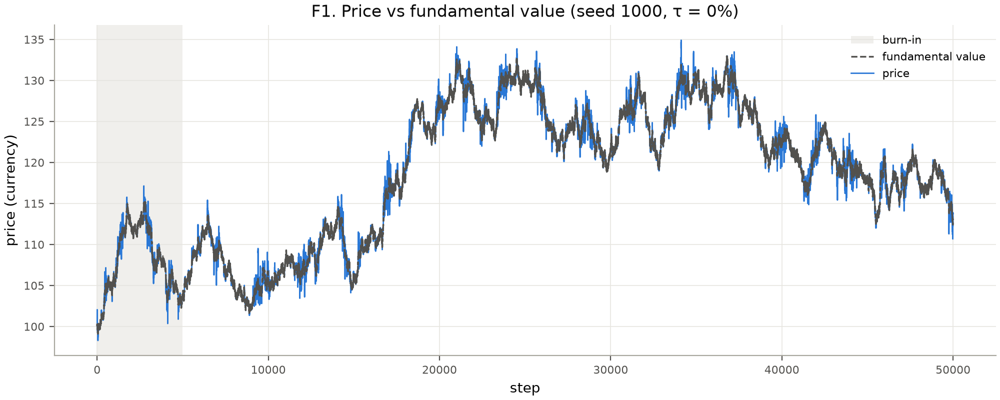
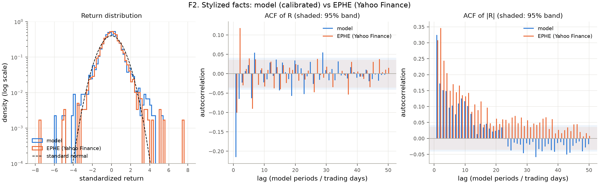
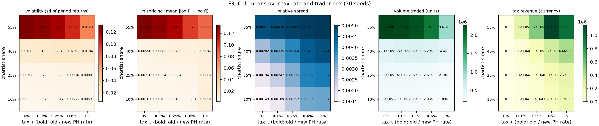
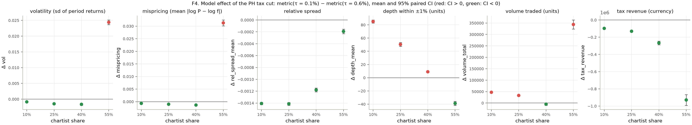
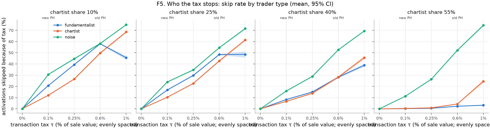
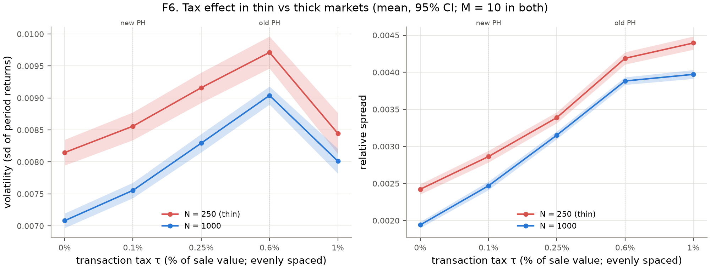
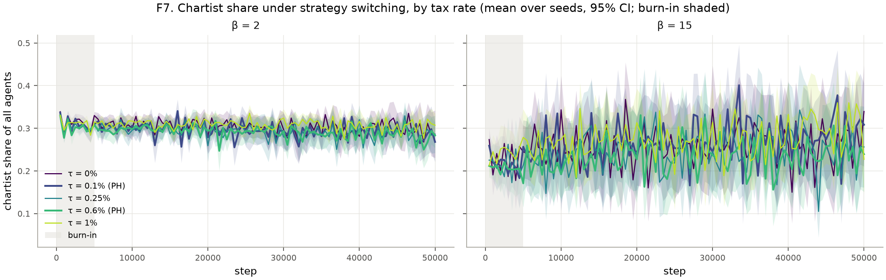
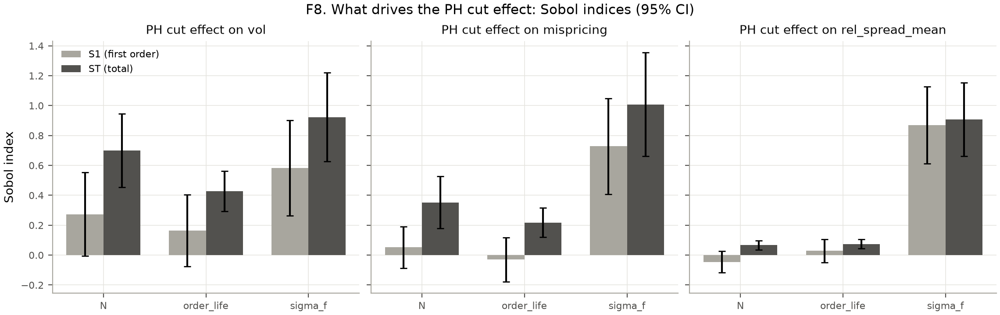

# Results

**These results describe the mechanism of a stylized model, not a forecast for the Philippine
Stock Exchange.** The model is described in [`ODD.md`](ODD.md); the commands to reproduce every
number and figure are in the [README](../README.md).

All experiments use `configs/calibrated.yaml` and 30 seeds per cell (1000–1029). Seeds are shared
across cells, so every tax comparison is **paired by seed** (common random numbers). Intervals are
95% t-intervals across seeds. No multiple-comparison correction is applied; the number of
intervals behind each verdict is stated with it.

"PH cut effect" means the per-seed difference `metric(τ = 0.1%) − metric(τ = 0.6%)`: what the
model says the 0.6% → 0.1% cut does. A negative number means the cut lowers the metric.

---

## Summary

| Question | Model answer |
|---|---|
| H1: does the tax hit chartist and noise trading harder than fundamentalist trading? | **Mixed** (8 of 16 cells). Noise traders are always hit hardest. Chartists vs fundamentalists depends on the mix. |
| H2: in chartist-heavy markets, does a higher tax lower volatility and mispricing? | **Mixed.** Yes at 55% chartists (every τ). No at 40% chartists, where the tax *raises* both. |
| H3: in thin markets, does a higher tax raise volatility through price impact? | **Supported.** At N = 250 the tax raises volatility and spread and lowers depth. It does so in the thick market (N = 1,000) too. |
| What did the PH cut do? | It **lowers** volatility, mispricing and spreads at 10–40% chartists, where the liquidity effect dominates. It **raises** volatility and mispricing at 55% chartists, where the composition effect dominates. |
| Does strategy switching change this? | With mild switching the cut's effect on volatility is not significant; with strong switching (herding) the cut raises volatility. |
| What drives the size of the PH cut effect? | The volatility of the fundamental value (σ_f), by far. |

---

## E1: Calibration (F1, F2)

**Target.** The shape of daily returns of the iShares MSCI Philippines ETF (EPHE, 2015–2026,
2,986 returns). EPHE stands in for the PSEi, which has no usable history on Yahoo Finance. It is
USD-priced, so its returns include the PHP/USD exchange rate. Both series are standardized, since
a model step has no calendar meaning.

**Outcome: partial calibration failure.**
- The 1,728-point grid (and its v1 predecessor) found no parameter set that passes all five
  validation checks.
- The binding conflict is between **volatility clustering** and a **near-zero lag-1 return
  autocorrelation**. Settings with clustering show a lag-1 reversal of −0.3 to −0.5. Measuring
  returns from the mid price does not remove it, so it is genuine overshooting, not bid-ask bounce.
- A first calibrated point passed the original four checks only because the price followed an
  ~88-step deterministic cycle. That point was withdrawn, and a fifth "no cycle" check was added.
- With the user's approval, the final parameters are the best compromise: pass kurtosis, Hill and
  no-cycle, then lowest moment distance D.

| Moment (standardized returns) | Model (30-seed mean) | EPHE | Target | Pass |
|---|---|---|---|---|
| Excess kurtosis | 4.24 | 38.3 | > 1 | yes |
| Hill tail index | 3.28 | 3.22 | 2–6 | yes |
| ACF of R, lag 1 | −0.27 | −0.10 | \|·\| < 0.1 | **no** |
| ACF of \|R\|, lags 1–10 (mean) | 0.15 | 0.20 | above band at lags 1–20 | **partly** (16/20 lags) |
| ACF of \|R\|, lags 11–50 (mean) | −0.005 | 0.051 | — | — |
| \|ACF of R\| at lags 2–5 | < 0.1 | — | < 0.1 | yes |

The tail index matches EPHE closely. Kurtosis is lower than EPHE's, whose value is driven by the
2020 crash (bootstrap sd ≈ 20). Clustering is present but decays faster than in the data: it is
gone by lag ~20. Calibrated parameters: tau_f 12.5, σ_eps 0.0002, k_max 0.01, price band 0.00875,
order_life 200, volatility feedback gamma 3.

Details: `results/e1_calibration/compromise_report.md`; earlier attempts are archived under
`results/e1_calibration/`.

---

## E2: Tax × trader mix (F3, F4, F5): H1, H2, PH cut

Grid: τ ∈ {0, 0.1%, 0.25%, 0.6%, 1%} × chartist share ∈ {10%, 25%, 40%, 55%}, 600 runs.

**Volatility (sd of 20-step returns), cell means**

| chartist share | τ = 0 | 0.1% | 0.25% | 0.6% | 1% |
|---|---|---|---|---|---|
| 10% | 0.0053 | 0.0058 | 0.0062 | 0.0066 | 0.0059 |
| 25% | 0.0071 | 0.0076 | 0.0083 | 0.0090 | 0.0080 |
| 40% | 0.0168 | 0.0189 | 0.0204 | 0.0205 | 0.0184 |
| 55% | 0.132 | 0.127 | 0.120 | 0.103 | 0.072 |

Two regimes appear:
- **10–40% chartists:** the tax raises volatility up to 0.6% and spreads at every rate, and lowers
  depth up to 0.6%. This is the liquidity effect. At 1% the volatility rise partly reverses.
- **55% chartists:** the market is in a boom-bust regime (volatility ~20× the 25% case,
  mispricing ≈ 0.13). Here the tax steadily **lowers** volatility and mispricing, by 45% and 38%
  at τ = 1%. This is the composition effect.

### PH cut effect (F4)

`metric(0.1%) − metric(0.6%)`, mean [95% CI], 30 paired seeds:

| chartist share | Δ vol | Δ mispricing | Δ rel. spread | Δ depth (units) |
|---|---|---|---|---|
| 10% | −0.00086 [−0.00092, −0.00081] | −0.00069 [−0.00070, −0.00067] | −0.0014 [−0.0014, −0.0014] | +85 [+83, +87] |
| 25% | −0.0015 [−0.0016, −0.0014] | −0.0010 [−0.0011, −0.0010] | −0.0014 [−0.0014, −0.0014] | +50 [+48, +53] |
| 40% | −0.0016 [−0.0020, −0.0013] | −0.0013 [−0.0014, −0.0012] | −0.0012 [−0.0012, −0.0011] | +9 [+8, +10] |
| 55% | **+0.024** [+0.024, +0.025] | **+0.031** [+0.030, +0.032] | −0.0002 [−0.0002, −0.0002] | **−39** [−42, −36] |

**The sign of the cut's effect on price stability flips between 40% and 55% chartists.**
- At 10–40% chartists, the cut makes the market calmer, more liquid and closer to fundamental
  value: volatility falls by about 8–17% of its level at 0.6%.
- In the chartist-dominated regime it lets more trend-following trades through, and booms and
  busts grow.
- Tax revenue falls at every mix: the lower rate is not made up by the extra volume.

### H1: who the tax stops (F5)

**Verdict: mixed** (H1 holds in 8 of 16 cells; 32 intervals inspected). H1 requires the drop in
fills per agent from τ = 0 to be larger for chartists and for noise traders than for
fundamentalists, with non-overlapping CIs.
- **Noise traders are hit hardest everywhere.** At τ = 1% their fills fall by 50–69%, and 11–75% of
  their activations are skipped because of the tax.
- **Chartists vs fundamentalists depends on the mix.**
  - At low taxes (0.1–0.25%) chartist fills often *rise*: chartists take trades that departing
    noise traders would have made.
  - At 10% chartists, fundamentalists lose more than chartists. At 1% tax, chartists lose more at
    25–40%.

The tax therefore acts mainly as a filter on noise trading, not on trend-following specifically.

### H2: chartist-heavy markets

**Verdict: mixed** (16 intervals inspected). Paired differences vs τ = 0:

| chartist share | τ | Δ vol | Δ mispricing |
|---|---|---|---|
| 40% | 0.6% | +0.0038 [+0.0034, +0.0041] | +0.0026 [+0.0025, +0.0028] |
| 40% | 1% | +0.0017 [+0.0012, +0.0021] | +0.0039 [+0.0030, +0.0047] |
| 55% | 0.6% | −0.029 [−0.030, −0.028] | −0.037 [−0.038, −0.036] |
| 55% | 1% | −0.059 [−0.061, −0.057] | −0.051 [−0.055, −0.047] |

At 55% chartists every τ > 0 lowers both metrics, so H2 holds. At 40% every τ > 0 raises both,
so H2 fails. The calming effect needs the market to be chartist-dominated.

---

## E2b: Tax × market thinness (F6): H3

Grid: τ (same 5) × N ∈ {250, 1000}, baseline mix, M = 10 activations per step in both, 300 runs.
With M fixed, each agent in the thin market acts four times as often. "Thin" here means fewer
distinct traders and fewer resting orders.

**Verdict: supported** (12 intervals inspected). At N = 250, vs τ = 0:

| τ | Δ vol | Δ rel. spread | Δ depth (units) |
|---|---|---|---|
| 0.1% | +0.00041 [+0.00031, +0.00051] | +0.00044 [+0.00042, +0.00046] | −20.5 [−21.4, −19.5] |
| 0.25% | +0.0010 [+0.0009, +0.0011] | +0.00097 [+0.00093, +0.00100] | −34.1 [−36.1, −32.1] |
| 0.6% | +0.0016 [+0.0014, +0.0017] | +0.0018 [+0.0017, +0.0018] | −36.8 [−39.2, −34.5] |
| 1% | +0.0003 [+0.0001, +0.0005] | +0.0020 [+0.0019, +0.0020] | −27.2 [−29.4, −25.1] |

**Caveat.** The thick market (N = 1,000) shows the same pattern with similar size (e.g. Δ vol at
0.6%: +0.0020). The thin market starts from higher volatility and spreads, and has about 40% of
the depth. So the tax works through a thinner book in both cases. H3's prediction holds, but
thinness does not create a distinct effect.

---

## E3: Tax with strategy switching (F7)

Grid: τ (same 5) × β ∈ {2 (mild), 15 (strong)}, baseline starting mix, switching every 500
steps, 300 runs. β was chosen from a pilot (the typical profit gap between strategies is ~0.23
per window).

| | β = 2 | β = 15 |
|---|---|---|
| mean chartist share (τ = 0) | 0.30 | 0.26 |
| round-to-round sd of chartist share (τ = 0 → 1%) | 0.084 → 0.061 | 0.255 → 0.206 |
| volatility at τ = 0 | 0.022 | 0.089 |
| PH cut effect on vol | +0.0033 [−0.0011, +0.0076] (n.s.) | **+0.021** [+0.016, +0.026] |
| PH cut effect on mispricing | +0.0005 [−0.0016, +0.0025] (n.s.) | **+0.039** [+0.029, +0.050] |
| PH cut effect on rel. spread | −0.0014 [−0.0014, −0.0013] | −0.0011 [−0.0011, −0.0010] |

- **Switching makes the market more volatile** than the fixed 25%-chartist market (volatility
  3× at β = 2, 13× at β = 15). Agents keep moving into the chartist strategy when it has just paid.
- **Strong switching produces herding.** The non-noise population lurches between strategies:
  the chartist share swings by ±0.25 between rounds. Averaged over seeds (F7), the share hovers
  around 0.25, but single runs swing widely.
- **The tax barely changes the average mix** (shifts of ≤ 0.024 in the chartist share). It does
  damp the swings: at 1% tax the swing sd falls by a fifth to a quarter.
- **The PH cut, under strong switching, raises volatility and mispricing**, as in the
  chartist-dominated E2 regime. Under mild switching its effect on volatility and mispricing is
  not significant. In both cases the cut narrows spreads.

---

## E4: Global sensitivity of the PH cut effect (F8)

Sobol design over N ∈ [250, 2000], order_life ∈ [50, 500], σ_f ∈ [0.0005, 0.002]: 512 points ×
2 tax rates, one seed per point (1,024 runs). The output is the PH cut effect on each metric.

| output | S1 σ_f | ST σ_f | ST N | ST order_life |
|---|---|---|---|---|
| Δ vol | 0.58 ± 0.32 | 0.92 ± 0.30 | 0.70 ± 0.24 | 0.43 ± 0.13 |
| Δ mispricing | 0.73 ± 0.32 | 1.01 ± 0.35 | 0.35 ± 0.17 | 0.22 ± 0.10 |
| Δ rel. spread | 0.87 ± 0.26 | 0.91 ± 0.25 | 0.07 ± 0.03 | 0.07 ± 0.03 |

- **The volatility of the fundamental value (σ_f) dominates** every output. A plausible channel:
  σ_f sets the typical expected gain, and so how many trades the 0.1% and 0.6% taxes filter out.
  The Sobol analysis does not test this channel.
- For volatility, N also matters, mostly through interactions (ST ≫ S1). This is consistent with
  E2b: the cut's effect depends on how thin the book is.
- **Treat E4 as indicative.** With one seed per point, simulation noise enters the indices, and
  the CIs are wide (±0.3).

---

## Limitations

- **Partial calibration.** The model's lag-1 return autocorrelation (≈ −0.27) is more negative than
  in the data, and its volatility clustering decays faster. The empirical target is an ETF (EPHE),
  not the PSEi.
- **Regime dependence.** The headline sign flip comes from a boom-bust regime at 55% chartists (and
  under strong switching). Whether real markets are ever in such a regime is outside the model.
- **Imposed clustering.** Volatility clustering comes partly from an imposed feedback: forecast noise
  scales with recent volatility.
- **Stylized microstructure:**
  - one asset;
  - a price band on orders;
  - signal-sized orders;
  - no budget constraints;
  - unlimited short selling;
  - agents see the true fundamental value.
- **Calendar.** A model step has no calendar meaning; only the shape of returns is calibrated.
- **Tax design.** The tax is seller-side only; other designs are not studied.
- **Multiple comparisons.** No correction is applied. Each verdict states how many intervals it
  rests on.
- **Scope.** The results show mechanisms in a stylized model, not predictions for the PSE.
